# Sprint 1 · Montaje

En este sprint monté las dos máquinas virtuales con particionado manual, configuré la red, el acceso SSH y tomé las instantáneas de instalación limpia.

## Entregable 1: VM Gráfica (`g03-grafica` - Fedora Workstation 45)

**Comandos usados:**

```bash
lsblk
df -h
cat /etc/fstab
```

**Explicación del particionado:**

- `/` (14 GB): Sistema operativo, aplicaciones y el entorno gráfico GNOME.
- `swap` (3.7 GB): Respaldo de memoria para el escritorio.
- `/home` (7.3 GB): Datos del usuario marco.

Nota: El instalador de Fedora creó automáticamente una partición de arranque de 1 MB.

**Captura de particiones:**

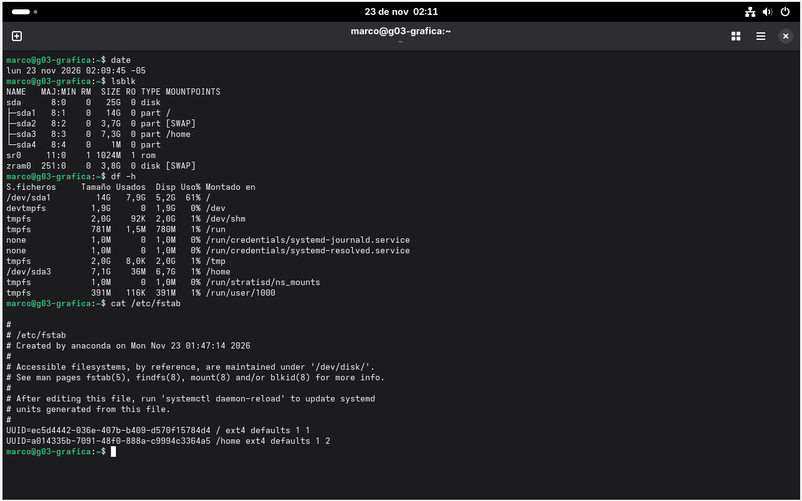

**Captura de navegadores y editores:**

Se instalaron Chromium y Firefox (navegadores), junto con GNOME Text Editor y Gedit (editores).

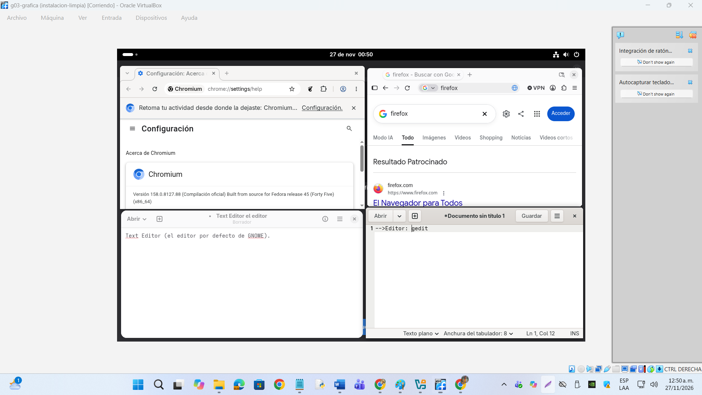

---

## Entregable 2: VM Consola (`g03-consola` - Ubuntu Server 26.04 LTS)

**Comandos usados:**

```bash
lsblk
df -h
cat /etc/fstab
```

**Explicación del particionado:**

- `/` (6 GB): Sistema base y paquetes esenciales del servidor.
- `/var` (10 GB): Datos de servicios y Docker (`/var/lib/docker`).
- `swap` (2 GB): Respaldo de memoria.
- `/home` (7 GB): Datos del usuario marco.

**Captura de particiones:**

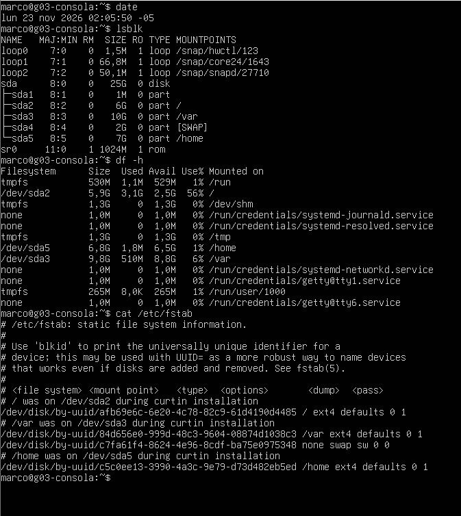

**Captura de las 5 herramientas:**

Se verificó la instalación de make, rsync, curl, git y wget.

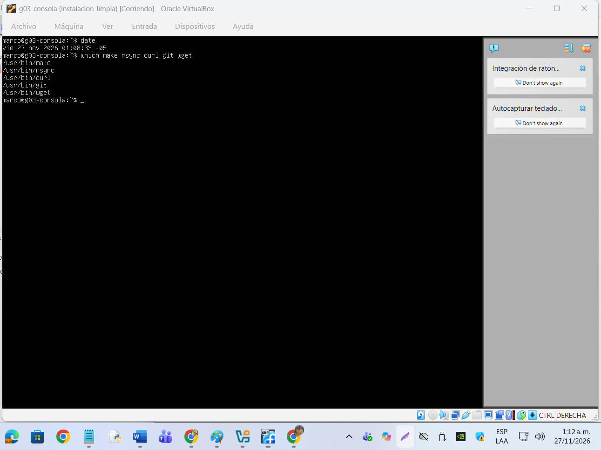

---

## Entregable 3: Red

Las dos VMs se ven entre sí a través de la red Solo-Anfitrión.

**Captura de Red (desde la VM Gráfica):**

Se muestra el comando `ip a` y el ping exitoso hacia la IP de la consola (192.168.56.101), con cero paquetes perdidos.

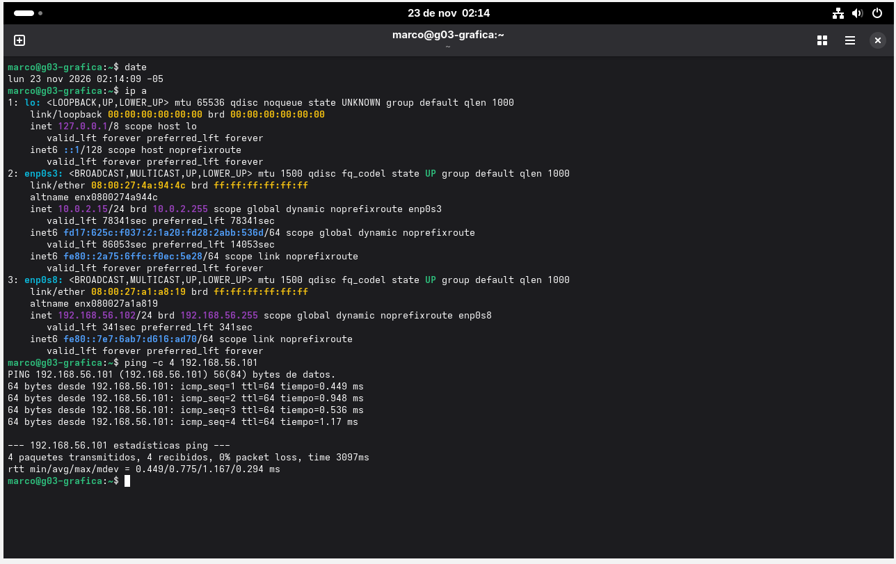

**Captura de Red (desde la VM Consola):**

Se muestra el comando `ip a` y el ping exitoso hacia la IP de la gráfica (192.168.56.102), con cero paquetes perdidos..

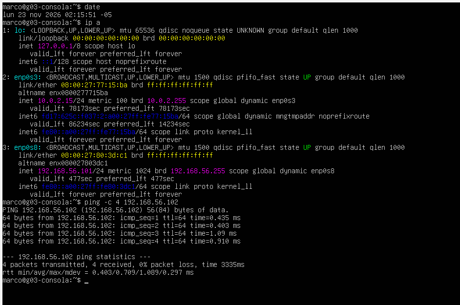

---

## Entregable 4: SSH

Conexión desde `g03-grafica` hacia `g03-consola` sin necesidad de usar la interfaz de VirtualBox.

**Captura de la sesión SSH abierta:**

Se observa el prompt `marco@g03-consola` dentro de la ventana de la VM gráfica, y el comando `date`.

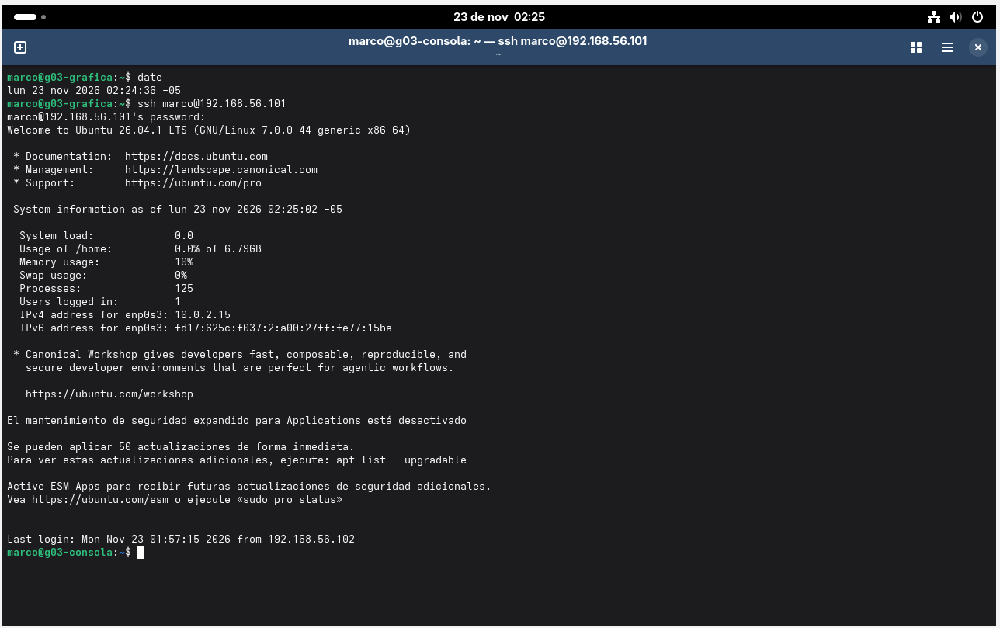

---

## Entregable 5: Instantáneas

Se tomaron las instantáneas llamadas `instalacion-limpia` en ambas máquinas con la VM apagada.

**Captura instantánea Fedora:**

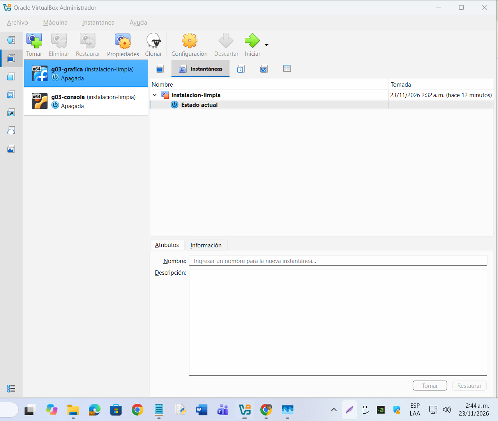

**Captura instantánea Ubuntu:**

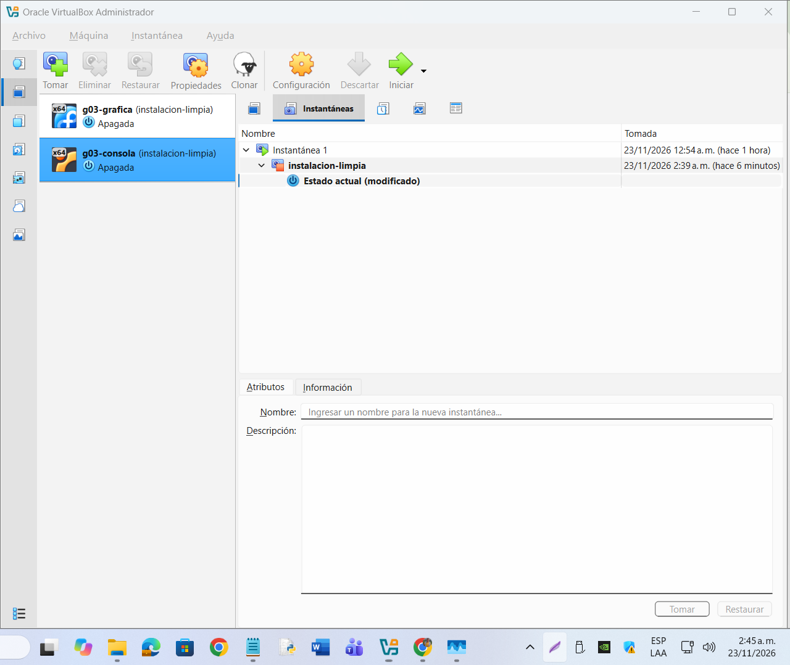

---

## Código del Sprint 1

El código del Grupo 03 es **YN03-3YXM**. Se guardó en el archivo `~/codigo_sprint1.txt` en ambas máquinas.

**Captura código en Gráfica:**

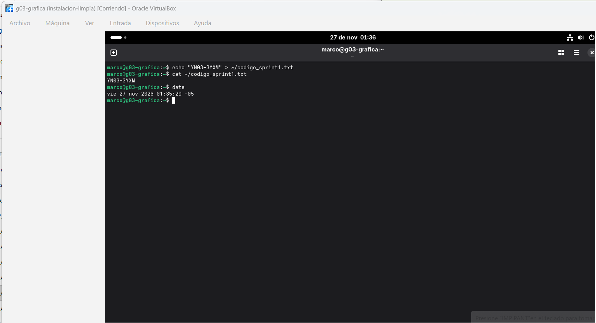

**Captura código en Consola:**

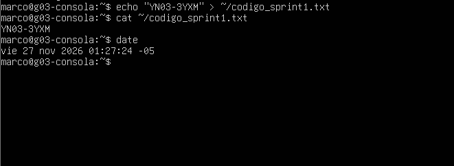

---

## Video del Sprint 1

[Ver video del Sprint 1 en YouTube](https://youtu.be/lr9RozEJjYA)
